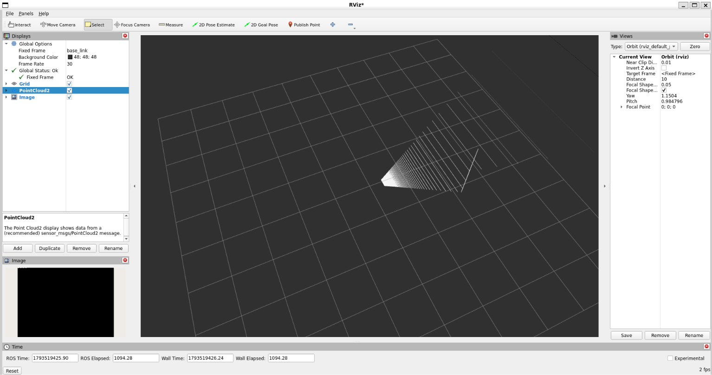
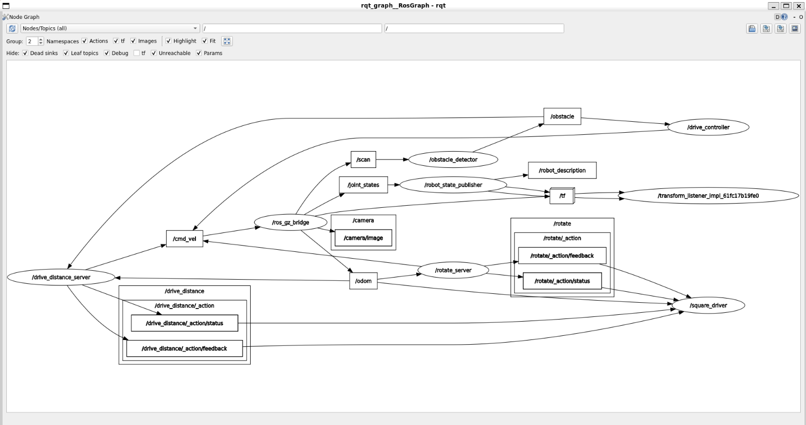

# Lab 1: ROS 2 and Custom Robot Simulation

**Student:** Tewobsta Migbar Liyew  
**Environment:** Ubuntu 22.04, ROS 2 Humble, Gazebo Harmonic  
**Course:** Introduction to Robotics and Intelligent Systems  
**University:** Addis Ababa University

## My Lab 1 Implementation

This repository contains my implementation of Lab 1, including the depth camera, IMU, ROS 2 nodes, custom interfaces, services, and robot control functionality.

### 1. Depth Camera and Point Cloud in RViz

The following screenshot shows the robot's depth camera image and point cloud visualization in RViz.



### 2. ROS 2 Node Communication Graph

The following screenshot shows the ROS 2 node and topic communication graph captured using rqt_graph.

## 

## Project Overview

This project implements the first robotics laboratory exercise using ROS 2 and Gazebo. It extends a differential-drive robot with additional sensors and custom ROS 2 functionality.

## Project Structure

```text
lab1_exercise/
├── diffdrive_bot/
├── lab_interfaces/
├── my_robot_interfaces/
├── my_robot_nodes/
├── depth_camera_rviz.png
├── rqt_graph.png
└── README.md
```

## Implementation

### Step 1 – Depth Camera and IMU

- Added a depth camera to the robot's URDF/Xacro model.
- Added an IMU sensor.
- Configured Gazebo sensor plugins and ROS 2 topic bridges.
- Verified the sensor topics and visualized the depth camera and point cloud in RViz.

### Step 2 – Obstacle Avoidance Node

- Implemented a Python node that subscribes to `/obstacle`.
- Published velocity commands to `/cmd_vel`.
- Made the robot move forward when the path is clear and turn away from obstacles.

### Step 3 – ROS 2 Parameters

- Added `forward_speed` and `turn_speed` parameters.
- Read parameter values dynamically so changes take effect while the node is running.

### Step 4 – Custom Robot Status Message

Created `RobotStatus.msg` with:

```text
string state
float32 obstacle_distance
```

Published the robot's current state and obstacle distance through `/robot_status`.

### Step 5 – Services

- Implemented `/turn_away_enable` using `std_srvs/SetBool`.
- Created a custom `/set_turn_speed` service.
- Added speed validation using the `max_turn_speed` parameter.

### Step 6 – Custom Rotate Action

Implemented the custom `Rotate.action` interface and rotation action server.

## Original Lab Session Overview

The session takes you from the basic ideas of ROS 2 to a simulated robot that you program yourself. It has three parts.

1. **ROS 2 concepts on turtlesim.** Work through the official ROS 2 beginner tutorials using Python and turtlesim. This introduces nodes, topics, services, parameters, actions, launch files, workspaces, and packages. See the [ROS 2 Humble tutorials](https://docs.ros.org/en/humble/Tutorials.html).

2. **A robot of your own in Gazebo.** Build the lab packages and follow the [diffdrive_bot README](https://github.com/Tewobsta13/intro_robotics_intelligent_systems_labs/blob/main/lab_01/diffdrive_bot/README.md).

3. **Exercise.** Extend the robot with a depth camera and IMU, then create your own ROS 2 packages and nodes. See the [original exercise instructions](https://github.com/Tewobsta13/intro_robotics_intelligent_systems_labs/blob/main/lab_01/EXERCISE.md).

## Requirements

- Ubuntu 22.04
- ROS 2 Humble
- Gazebo Harmonic
- ROS 2 Gazebo integration packages

## What I Learned

Through this laboratory exercise, I practiced:

- Creating and building ROS 2 packages.
- Working with URDF/Xacro robot descriptions.
- Integrating sensors into Gazebo simulations.
- Communicating through ROS 2 topics.
- Using parameters and services.
- Creating custom messages, services, and actions.
- Implementing robot control logic using Python.

## License

The original lab packages are released under the MIT license. See the [original repository](https://github.com/Tewobsta13/intro_robotics_intelligent_systems_labs/blob/main/LICENSE).
