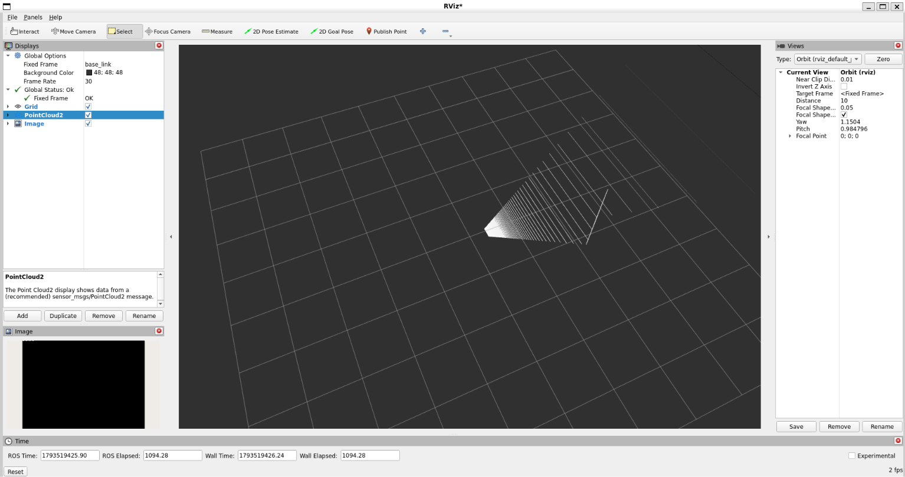
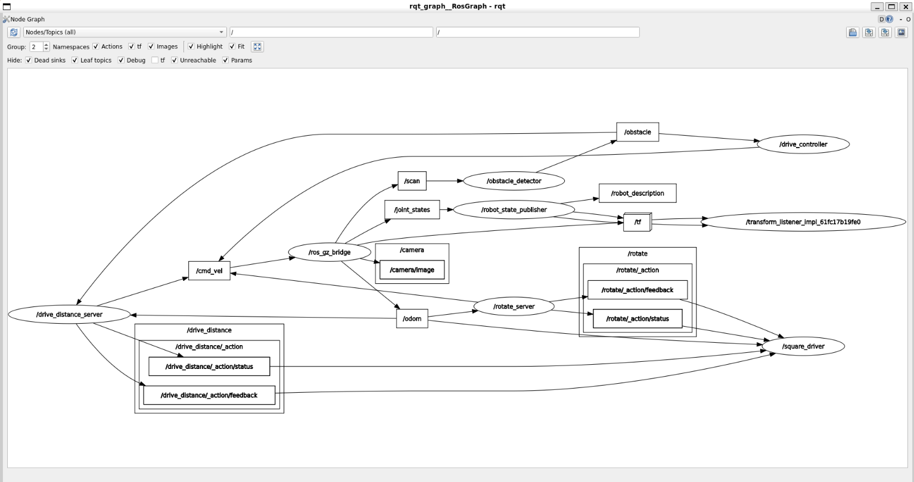

# Introduction to Robotics and Intelligent Systems – Lab 1

**Student:** Tewobsta Migbar Liyew  
**Environment:** Ubuntu 22.04, ROS 2 Humble, Gazebo Harmonic

## Project Overview

This project implements the first robotics laboratory exercise using ROS 2 and Gazebo. It extends a differential-drive robot with a depth camera and IMU, obstacle avoidance, custom messages and services, action servers, and an autonomous square-driving action client.

## Project Structure

    lab1_exercise/
    ├── diffdrive_bot/
    ├── lab_interfaces/
    ├── my_robot_interfaces/
    ├── my_robot_nodes/
    ├── depth_camera_rviz.png
    ├── rqt_graph.png
    └── README.md

## Implementation

### Step 1 – Depth Camera and IMU

- Added a depth camera to the robot's URDF/Xacro model.
- Added an IMU sensor.
- Configured the Gazebo plugins.
- Configured the ROS-Gazebo bridge.

Relevant topics:

- `/depth_camera/image`
- `/depth_camera/points`
- `/depth_camera/camera_info`
- `/imu`

### Step 2 – Obstacle Avoidance

Implemented the `turn_away` node.

- Subscribes to `/obstacle`.
- Publishes velocity commands to `/cmd_vel`.
- Moves forward when the obstacle is not too close.
- Rotates away when an obstacle is detected nearby.

### Step 3 – ROS Parameters

Added configurable parameters:

- `forward_speed` – default: `0.2`
- `turn_speed` – default: `0.5`

The node reads the parameters when processing obstacle messages.

### Step 4 – Custom Robot Status Message

Created `my_robot_interfaces/msg/RobotStatus.msg`:

    string state
    float32 obstacle_distance

The node publishes the robot's state (`forward`, `turning`, or `stopped`) and obstacle distance on `/robot_status`.

### Step 5 – ROS Services

Implemented two services.

**1. `/turn_away_enable`**

Uses `std_srvs/srv/SetBool` to enable or disable obstacle avoidance.

**2. `/set_turn_speed`**

Uses a custom `SetTurnSpeed.srv` service to update the turning speed.

The maximum allowed turning speed is controlled by the `max_turn_speed` parameter (default: `1.5`).

### Step 6 – Rotate Action Server

Created `my_robot_interfaces/action/Rotate.action`:

    float32 angle
    ---
    float32 turned
    ---
    float32 turned

Implemented the `rotate_server` action server on `/rotate`.

- Rotates by the requested angle.
- Publishes feedback showing the angle turned.
- Uses odometry to measure rotation.
- Supports cancellation and stops the robot when cancelled.
- Rejects zero-angle goals.

### Step 7 – Autonomous Square Driving

Implemented the `square_driver` action client.

- Sends goals to `/drive_distance` and `/rotate`.
- Drives four sides of a square.
- Turns left by 90 degrees after each side.
- Waits for each action result before continuing.
- Stops and logs an error if an action fails.

Created `square.launch.py` to launch the simulation, action servers, and square driver together.

## How to Build and Run

Source the ROS 2 environment:

    source /opt/ros/humble/setup.bash

Build the workspace:

    cd ~/ros2_ws
    colcon build

Source the workspace:

    source ~/ros2_ws/install/setup.bash

Launch the complete square-driving demonstration:

    ros2 launch my_robot_nodes square.launch.py side_length:=0.8

The robot should drive four sides of the square and turn left after each side.

## Screenshots

### Depth Camera in RViz

The depth camera point cloud and image are displayed in RViz.

### ROS Node Communication Graph

The ROS node and topic communication graph captured using rqt_graph.

## Challenges and Lessons Learned

During testing, the square driver initially attempted to send a drive goal before odometry data was available. The drive-distance action server rejected the goal because it did not yet have an initial robot position.

I resolved this by subscribing to `/odom` in the square driver and waiting until the first odometry message arrived before starting the square-driving sequence.

This demonstrated the importance of waiting for sensor data and ensuring that ROS nodes are ready before sending action goals.

## Technologies Used

- ROS 2 Humble
- Ubuntu 22.04
- Gazebo Harmonic
- Python
- C++
- URDF/Xacro
- ROS 2 Topics, Parameters, Services, and Actions
- RViz
- rqt_graph
